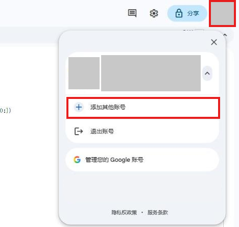
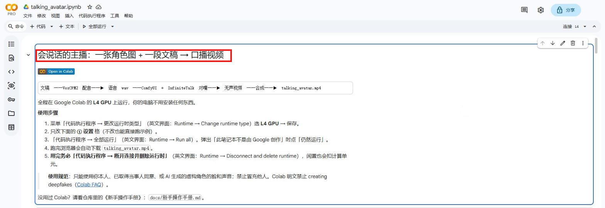
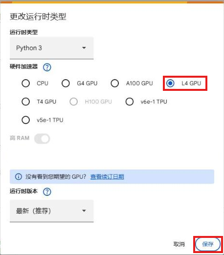
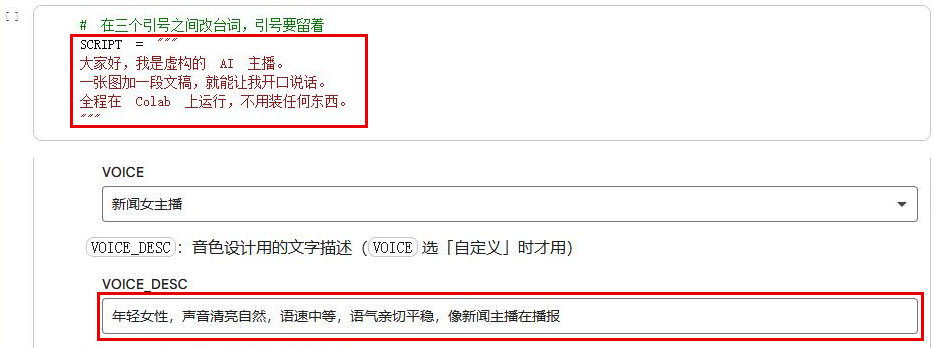
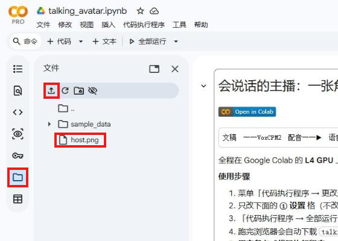
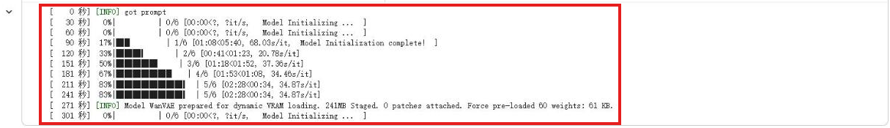
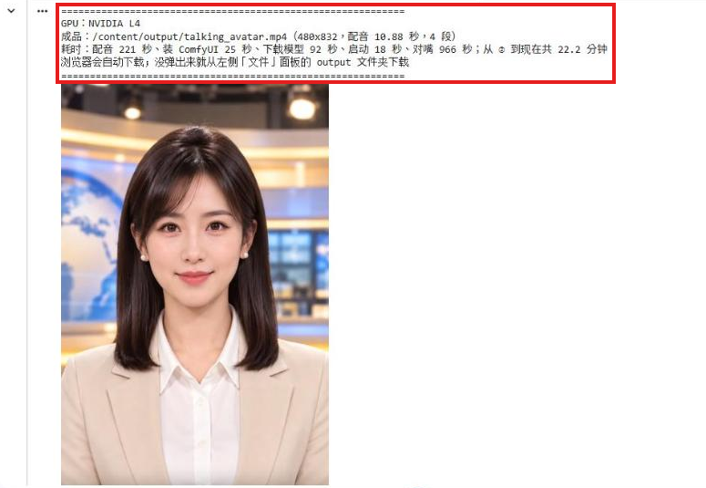
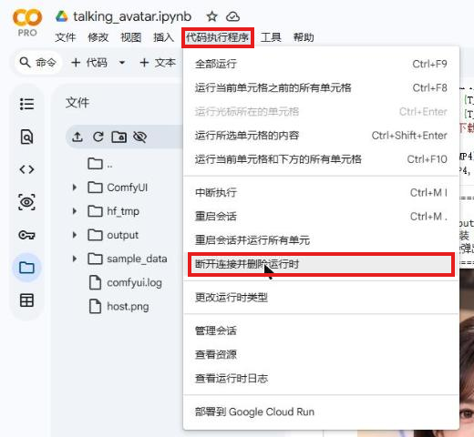

# 新手操作手册

写给**完全没用过 Colab、不会写程序**的人。每节一个动作，对上「做对了会看到」再往下。

四个词：

- **notebook（笔记本）**：网页上的程序文件，由一格一格组成。灰底的是可运行的“代码格”。本项目就是 `talking_avatar.ipynb`。
- **GPU（显卡）**：做大量计算的硬件，用 Google 机房的，你的电脑不需要有。
- **运行时（runtime）**：Google 临时借你的云端电脑，notebook 在上面跑。用完要删，否则继续计费。
- **计算单元（compute units）**：Colab 的计费点数，用 L4 GPU 会按时间扣。

---

## 准备篇

### 第 1 步：准备 Google 账号

**要做的**：用有计算单元的 Google 账号（Gmail 就是）。浏览器登录了多个账号时，Colab 默认用第一个，最稳妥是开“无痕／隐私窗口”，只登录这个账号，再打开 <https://colab.research.google.com>。

**做对了会看到**：点右上角头像，菜单上方是要用的账号。

### 第 2 步：确认账号里有计算单元

本项目需要 **L4 GPU**，要用计算单元（Colab 购买，或 Google AI Pro 等方案附送）。

**要做的**：打开 <https://colab.research.google.com/signup>。

**做对了会看到**：「Pay As You Go」下方写着“您目前有 N 个计算单元。”。余额是 0，选 L4 会失败或被降成 T4。

---

## 开始运行

### 第 3 步：打开 notebook

**要做的**：在本项目的 GitHub 页面（README 最上方）点 **Open in Colab** 徽章。

**做对了会看到**：标题是 `talking_avatar.ipynb`，第一格是“会说话的主播……”。

### 第 4 步：选择 L4 GPU

**要做的**：点「代码执行程序 → 更改运行时类型」（Runtime → Change runtime type），“硬件加速器”选 **L4 GPU**，点「保存」。通常已选中 L4，确认后保存。

**做对了会看到**：点右上角“连接 L4”连接后，右下角显示 `L4（Python 3）`。

### 第 5 步：改文稿

**要做的**：找到 **① 文稿** 标题下面的代码格（程序码是展开的），把 `SCRIPT = """` 和下一个 `"""` 之间换成你的文稿。**一行一句**，每句别太长（超过 80 字会被自动切开）。不改可跳过。

**做对了会看到**：三个引号 `"""` 还在，中间是你的句子。句首可用括号写语气，如 `(轻松地)大家好，今天聊一个小工具。`

### 第 6 步：选声音

**要做的**：在 **①-2 设置** 格（这一格只显示表单，程序码收起来了）的「声音」一段，点 `VOICE` 下拉选单选一把声音（默认“新闻女主播”）。10 把声音都能先试听：README 的“声音包”一节，每把声音后面有「试听」链接。不改可跳过。

**做对了会看到**：表单里 `VOICE` 显示你选的声音。

想用文字描述自己造声音：`VOICE` 选“自定义（用 VOICE_DESC）”，再把 `VOICE_DESC` 文字框里换成你想要的声音（性别、年龄、音色、语速、语气）。示例：

- `年轻女性，声音清亮自然，语速中等，语气亲切平稳，像新闻主播在播报`
- `中年男性，嗓音低沉温和，语速偏慢，语气沉稳可靠，像纪录片旁白`

### 字幕设置（不改可跳过）

成品默认带字幕：思源黑体、单层黑色描边、每段字幕淡入。字幕文字就是你的文稿，不会有错字。

**要做的**：想换样式，在 ①-2 设置格表单的「字幕」那一段改：`SUBTITLE`（开关，取消勾选＝不要字幕）、`SUB_FONT`（字体）、`SUB_SIZE`（字号滑杆）、`SUB_EFFECT`（出现效果）、`SUB_POSITION`（位置）、`SUB_MARGIN`（离边缘多远）、`SUB_OUTLINE`（描边粗细）、`SUB_COLOR`／`SUB_OUTLINE_COLOR`（颜色，写成 `#FFFFFF` 这种格式）。

**做对了会看到**：表单里的值变成你选的。跑完之后还想换，不用重跑，见第 12 步后面的「想换字幕样式？」。

### 画面比例与去背（不改可跳过）

默认是 9:16 竖屏（480×832）、不去背。

**要做的**：在 ①-2 设置格的表单改：
- `ASPECT`（画面比例）：9:16 竖屏、16:9 横屏、1:1 方形、4:5、3:4。
- `CROP_POS`（裁切位置）：角色图比例和画面不同时裁掉哪一边，默认「偏上」保留头部。
- `BG_REMOVE`（去背）：想要透明背景的视频（之后放进别的模板用）时选「绿幕（推荐）」或「逐帧」。选「绿幕」时 `talking_avatar.mp4` 的背景会是绿色的，透明背景的版本是另外下载的 `talking_avatar_alpha.webm`（不带字幕）。

**做对了会看到**：①-2 格运行后显示绿色框 `✅ 设置已读取：画面 480x832，裁切「偏上（保留头部）」，去背「关」，版面「只有主播」` 这样的一行。各选项的详细说明见 README 的「画面比例」「去背」两节。

### 第 7 步：上传自己的角色图（不换图可跳过）

**要做的**（两种方法选一种）：

- **方法一（简单）**：在 **①-3 上传文件** 格勾选 `UPLOAD_IMAGE`（角色图）。等第 9 步「全部运行」跑到 ①-3 时，这一格下方会出现「选择文件」按钮，点它选**一张**图片。不用做第 8 步。
- **方法二**：点左侧**文件夹图标**（「文件」面板），再点上方“上传”图标，选图片。没有文件列表先点右上角「连接」。然后做第 8 步。

**做对了会看到**：方法一：①-3 格显示绿色框，写着「角色图：已上传 /content/你的图.png……」。方法二：文件列表里出现你的图片（在 `/content/` 里）；弹出文件会被删除的警告，点「确定」。

录影、BGM、字体文件、参考录音也一样能在 ①-3 勾选上传（录影很大时建议用方法二，在 ①-2 填 `REC_PATH`）。上传过的文件会一直沿用，之后重跑 ①-2 也不会丢；①-3 的勾上传完可以取消。

图片要求：比例接近 `ASPECT` 选的画面（默认**竖图**）、人物**正面**看镜头、**闭着嘴**、**脸够大**（上半身入镜，不要全身照）、**手不要入镜**。只能用你本人、已取得同意的人、或 AI 生成的虚构人物。文件名用英文或数字（如 `me.png`）。

### 第 8 步：把 IMAGE_PATH 改成你的图（只有第 7 步用方法二才要做）

**要做的**：在 ①-2 设置格「角色图」一段的 `IMAGE_PATH` 文字框里，把 `examples/host.png` 改成 `/content/你的图.png`（文件名大小写要一致）。

**做对了会看到**：`IMAGE_PATH` 文字框里是 `/content/me.png` 这样的路径。拿不准文件名：右键图片 →「复制路径」。

### 第 9 步：全部运行

**要做的**：点「代码执行程序 → 全部运行」（Runtime → Run all）。

**做对了会看到**：运行中的格转圈，跑完变绿勾，格子下方出现绿色「✅」框。①、①-2、② 格几秒跑完（第 7 步用了方法一的话，会停在 ①-3 等你选文件）；③-1 格开头出现黄色「⏳ 进行中」框，会转好几分钟，正常。

### 第 10 步：处理安全警告

**要做的**：弹出“警告：此笔记本不是由 Google 创作”时，点「**仍然运行**」（Run anyway）。没弹出就直接下一步。

**做对了会看到**：代码格继续运行。半分钟没有格在转圈，再点一次「全部运行」。

<!-- 截图：“此笔记本不是由 Google 创作”警告窗口，标出“仍然运行” -->

### 第 11 步：等待

**要做的**：保持分页开着，等。

**做对了会看到**：

- ② 格打印 `GPU：NVIDIA L4，显存 22.x GiB`（出现 `⚠ 警告` 看“常见问题”）。
- ③ 格跑完出现可试听的音频条。
- ④-5 格开头的黄色框写着这次分几段，之后每 30 秒打印一行 `[ xxx 秒] ...`，这是最久的一步。进度条走完 6 步是一段，之后回到 `0/6` 做下一段，正常。

耗时：示例文稿（配音 10.88 秒）共约 22 分钟，其中对嘴约 16 分钟。文稿越长越久。

### 第 12 步：下载成品

**要做的**：等 ⑤ 格打印出 `====` 框（开了去背的话，再等 ⑤-2 格打印出 `====` 框）。浏览器只会自动下载一个文件 `talking_avatar_outputs.zip`，解压后是 `talking_avatar.mp4`、字幕文件 `talking_avatar.srt` 和不带字幕的 `talking_avatar_nosub.mp4`；开了去背还有 `talking_avatar_alpha.webm`（选「绿幕」时还有绿幕图 `input_greenscreen.png`）。字幕和去背都关时直接下载 `talking_avatar.mp4`。

**做对了会看到**：下载文件夹里有 `talking_avatar_outputs.zip`（或 `talking_avatar.mp4`）。没下载：Chrome 网址栏右边出现下载被拦截的图标时，点它选允许；或到左侧文件面板 → `output` → 右键文件 →「下载」。

### 想换字幕样式？（可跳过，要在第 13 步之前做）

**要做的**：
1. 在 ①-2 设置格改「字幕」那一段（见第 6 步后面的「字幕设置」）。
2. 点 ①-2 设置格左边的 ▶ 运行它。
3. 往下找到标题为 **⑥ 只重做字幕** 的格子，点它左边的 ▶。

**做对了会看到**：⑥ 格打印「字幕已烧进画面」，浏览器下载 `talking_avatar_resub.zip`（里面是新的 `talking_avatar.mp4` 和 `talking_avatar.srt`；字幕关闭时直接下载 `talking_avatar.mp4`）。不会重跑配音和对嘴。

如果 ⑥ 格报错说「缺少前面格子定义的函数」：依次运行 ①、①-2、②、②-2、③-2 五格，再运行 ⑥。**不要**运行 ③-1（会重新配音）。

### 第 13 步：删除运行时（一定要做）

**要做的**：点「代码执行程序 → 断开连接并删除运行时」（Runtime → Disconnect and delete runtime）。

弹出确认窗口，点「是」。**注意：如果弹出的是提醒文件会被删除的“警告”窗口，按「确定」后，要再点一次「断开连接并删除运行时」才真正删除。**

**做对了会看到**：右上角变成“重新连接”。不删会继续扣计算单元。

---

## 常见问题

**② 格警告，GPU 显示 T4 不是 L4？**
账号没有计算单元或余额是 0。回第 1、2 步检查，改好后重做第 4 步，再「全部运行」。T4 没测试过，很可能失败。

**报错有 `OutOfMemory` 或 `OOM`（显存不够）？**
1. 「代码执行程序 → 重启会话」。
2. ①-2 设置格最下面「进阶：显存」勾选 `LOW_VRAM`。
3. 「代码执行程序 → 全部运行」。
会变慢但比较稳。

**中途断线了？**
分页关太久、电脑睡眠、断网都会让运行时断开，云端文件会消失。重新打开 notebook，从第 4 步再来。

**浏览器没有自动下载？**
Chrome 可能拦截了下载。网址栏右边出现下载被拦截的图标时，点它选“允许”；或到左侧文件面板 → `output` 文件夹 → 右键文件 →「下载」。

**成品没有声音？**
先听 ③ 格的音频条。有声音：换播放器（浏览器或 VLC）打开 mp4。没声音：检查文稿是否为空。

**嘴型对不上？**
检查角色图：正面、闭嘴、脸够大、嘴没被挡住。长句容易对不准，拆短。

**声音不喜欢？**
`VOICE` 换一把声音（先到 README“声音包”试听），再全部运行。用“自定义”时，可以换 `SEED` 的数字（如 42 改成 7）或改 `VOICE_DESC`。

**字幕和声音有点对不上？**
字幕时间是按每句配音长度估的，长句被切成几段时会有些偏差。把文稿的长句拆短（一行一句）。

**字幕出现方框或字体不一样？**
③-2 格会列出字体缺的字。在 ①-2 把 `SUB_FONT` 换成“思源黑体（粗）”（收的字最全），再照“想换字幕样式？”重做。

**去背选「绿幕」，边缘有绿边或背景没扣干净？**
在 ①-2 把 `BG_REMOVE` 改成“逐帧”，再「全部运行」。不想重跑对嘴：改完后运行 ①-2 格，再只运行 ⑤-2 格（发丝边缘可能还带一点绿）。

**透明 WebM 打开是黑底？**
有些播放器不支持透明 WebM，放进支持透明视频的剪辑或合成软件里才看得到。

**我想用自己的声音？**
可以，但只能用本人或已取得当事人同意的录音。做法见 README 的“声音克隆”一节，需在 ①-2 勾选 `I_HAVE_CONSENT`，否则 notebook 会直接停止。参考录音可以用 ①-3 勾「参考录音」上传。
