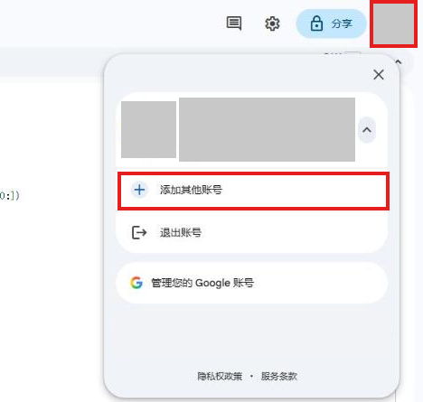
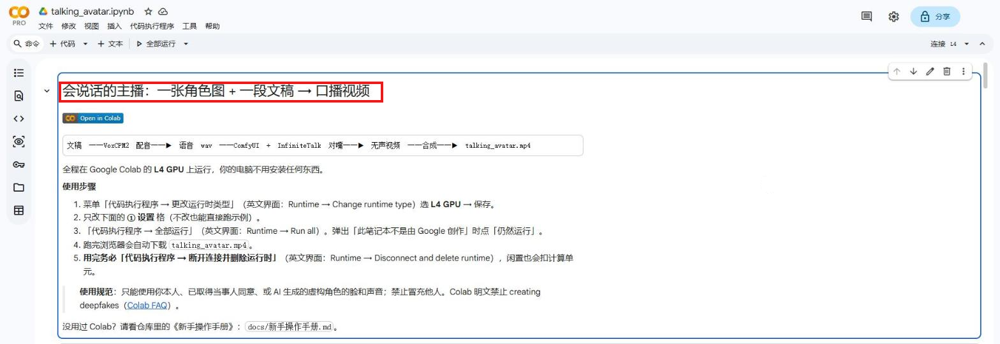
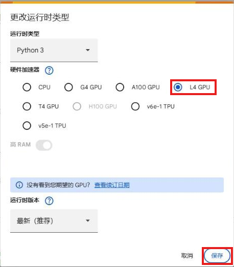
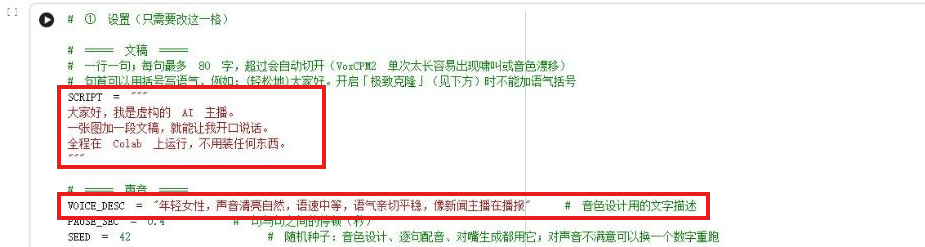
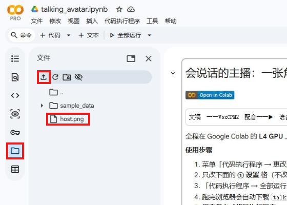
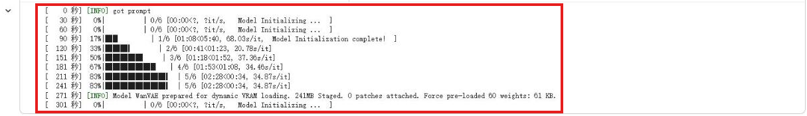
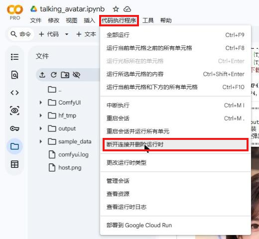

# 新手操作手册

写给**完全没用过 Colab、不会写程序**的人。每节一个动作，对上「做对了会看到」再往下。

四个词：

- **notebook（笔记本）**：网页上的程序文件，由一格一格组成。灰底的是可运行的“代码格”。本项目就是 `talking_avatar.ipynb`。
- **GPU（显卡）**：做大量计算的硬件，用 Google 机房的，你的电脑不需要有。
- **运行时（runtime）**：Google 临时借你的云端电脑，notebook 在上面跑。用完要删，否则继续计费。
- **计算单元（compute units）**：Colab 的计费点数，用 L4 GPU 会按时间扣。

---

## 准备篇

### 第 1 步：准备 Google 账号

**要做的**：用有计算单元的 Google 账号（Gmail 就是）。浏览器登录了多个账号时，Colab 默认用第一个，最稳妥是开“无痕／隐私窗口”，只登录这个账号，再打开 <https://colab.research.google.com>。

**做对了会看到**：点右上角头像，菜单上方是要用的账号。

### 第 2 步：确认账号里有计算单元

本项目需要 **L4 GPU**，要用计算单元（Colab 购买，或 Google AI Pro 等方案附送）。

**要做的**：打开 <https://colab.research.google.com/signup>。

**做对了会看到**：「Pay As You Go」下方写着“您目前有 N 个计算单元。”。余额是 0，选 L4 会失败或被降成 T4。

---

## 开始运行

### 第 3 步：打开 notebook

**要做的**：在本项目的 GitHub 页面（README 最上方）点 **Open in Colab** 徽章。

**做对了会看到**：标题是 `talking_avatar.ipynb`，第一格是“会说话的主播……”。

### 第 4 步：选择 L4 GPU

**要做的**：点「代码执行程序 → 更改运行时类型」（Runtime → Change runtime type），“硬件加速器”选 **L4 GPU**，点「保存」。通常已选中 L4，确认后保存。

**做对了会看到**：点右上角“连接 L4”连接后，右下角显示 `L4（Python 3）`。

### 第 5 步：改文稿

**要做的**：找到标题为 `# ① 设置（只需要改这一格）` 的代码格，把 `SCRIPT = """` 和下一个 `"""` 之间换成你的文稿。**一行一句**，每句别太长（超过 80 字会被自动切开）。不改可跳过。

**做对了会看到**：三个引号 `"""` 还在，中间是你的句子。句首可用括号写语气，如 `(轻松地)大家好，今天聊一个小工具。`

### 第 6 步：选声音

**要做的**：在 ① 设置格右侧的表单里，点 `VOICE` 下拉选单选一把声音（默认“新闻女主播”）。10 把声音都能先试听：README 的“声音包”一节，每把声音后面有「试听」链接。不改可跳过。

**做对了会看到**：`VOICE = "你选的声音"`。

想用文字描述自己造声音：`VOICE` 选“自定义（用 VOICE_DESC）”，再把 `VOICE_DESC = "..."` 引号里换成你想要的声音（性别、年龄、音色、语速、语气）。引号要留着。示例：

- `年轻女性，声音清亮自然，语速中等，语气亲切平稳，像新闻主播在播报`
- `中年男性，嗓音低沉温和，语速偏慢，语气沉稳可靠，像纪录片旁白`

### 第 7 步：上传自己的角色图（不换图可跳过）

**要做的**：点左侧**文件夹图标**（「文件」面板），再点上方“上传”图标，选图片。没有文件列表先点右上角「连接」。

**做对了会看到**：文件列表里出现你的图片（在 `/content/` 里）。弹出文件会被删除的警告，点「确定」。

图片要求：**竖图**、人物**正面**看镜头、**闭着嘴**、**脸够大**（上半身入镜，不要全身照）、**手不要入镜**。只能用你本人、已取得同意的人、或 AI 生成的虚构人物。文件名用英文或数字（如 `me.png`）。

### 第 8 步：把 IMAGE_PATH 改成你的图

**要做的**：在 ① 设置格里，把 `IMAGE_PATH = "examples/host.png"` 改成 `IMAGE_PATH = "/content/你的图.png"`（文件名大小写要一致）。

**做对了会看到**：`IMAGE_PATH = "/content/me.png"` 这样的一行。拿不准文件名：右键图片 →「复制路径」。

### 第 9 步：全部运行

**要做的**：点「代码执行程序 → 全部运行」（Runtime → Run all）。

**做对了会看到**：运行中的格转圈，跑完变绿勾。① ② 格几秒跑完，③ 格会转好几分钟，正常。

### 第 10 步：处理安全警告

**要做的**：弹出“警告：此笔记本不是由 Google 创作”时，点「**仍然运行**」（Run anyway）。没弹出就直接下一步。

**做对了会看到**：代码格继续运行。半分钟没有格在转圈，再点一次「全部运行」。

<!-- 截图：“此笔记本不是由 Google 创作”警告窗口，标出“仍然运行” -->

### 第 11 步：等待

**要做的**：保持分页开着，等。

**做对了会看到**：

- ② 格打印 `GPU：NVIDIA L4，显存 22.x GiB`（出现 `⚠ 警告` 看“常见问题”）。
- ③ 格跑完出现可试听的音频条。
- ④-5 格每 30 秒打印一行 `[ xxx 秒] ...`，这是最久的一步。进度条走完 6 步是一段，之后回到 `0/6` 做下一段，正常。

耗时：示例文稿（配音 10.88 秒）共约 22 分钟，其中对嘴约 16 分钟。文稿越长越久。

### 第 12 步：下载成品

**要做的**：等 ⑤ 格打印出 `====` 框。浏览器自动下载 `talking_avatar.mp4`，问“是否允许下载”就点允许。

**做对了会看到**：下载文件夹里有 `talking_avatar.mp4`。没下载：左侧文件面板 → `output` → 右键 `talking_avatar.mp4` →「下载」。

### 第 13 步：删除运行时（一定要做）

**要做的**：点「代码执行程序 → 断开连接并删除运行时」（Runtime → Disconnect and delete runtime）。

弹出确认窗口，点「是」。**注意：如果弹出的是提醒文件会被删除的“警告”窗口，按「确定」后，要再点一次「断开连接并删除运行时」才真正删除。**

**做对了会看到**：右上角变成“重新连接”。不删会继续扣计算单元。

---

## 常见问题

**② 格警告，GPU 显示 T4 不是 L4？**
账号没有计算单元或余额是 0。回第 1、2 步检查，改好后重做第 4 步，再「全部运行」。T4 没测试过，很可能失败。

**报错有 `OutOfMemory` 或 `OOM`（显存不够）？**
1. 「代码执行程序 → 重启会话」。
2. ① 设置格把 `LOW_VRAM = False` 改成 `LOW_VRAM = True`。
3. 「代码执行程序 → 全部运行」。
会变慢但比较稳。

**中途断线了？**
分页关太久、电脑睡眠、断网都会让运行时断开，云端文件会消失。重新打开 notebook，从第 4 步再来。

**成品没有声音？**
先听 ③ 格的音频条。有声音：换播放器（浏览器或 VLC）打开 mp4。没声音：检查文稿是否为空。

**嘴型对不上？**
检查角色图：正面、闭嘴、脸够大、嘴没被挡住。长句容易对不准，拆短。

**声音不喜欢？**
`VOICE` 换一把声音（先到 README“声音包”试听），再全部运行。用“自定义”时，可以换 `SEED` 的数字（如 42 改成 7）或改 `VOICE_DESC`。

**我想用自己的声音？**
可以，但只能用本人或已取得当事人同意的录音。做法见 README 的“声音克隆”一节，需把 `I_HAVE_CONSENT` 改成 `True`，否则 notebook 会直接停止。
